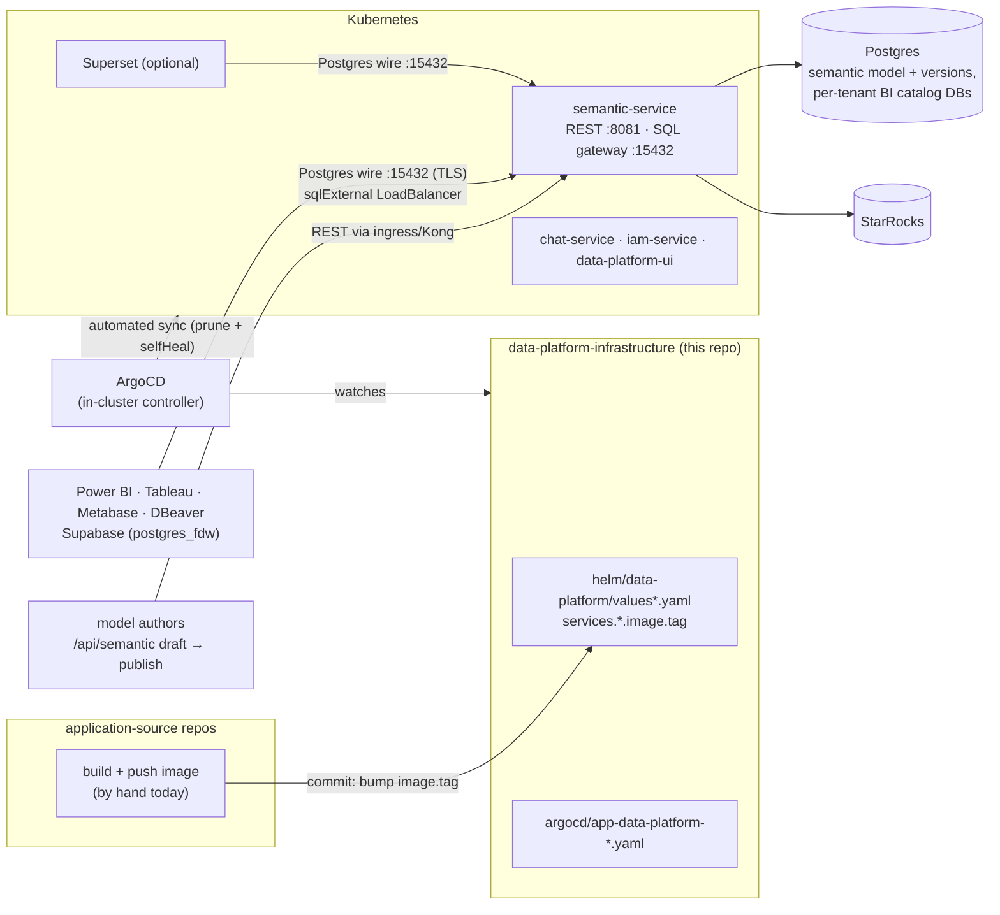

# data-platform GitOps — High-Level Design (HLD)

Feature: how the data platform reaches a cluster. Application images are deployed by a pull-based
GitOps loop — a commit to this repo is the only way the cluster changes, and **ArgoCD**, not CI,
applies it. The semantic model is not part of that loop any more: it lives in `semantic-service`'s
Postgres and is changed at runtime through its draft → publish API, with its own versions and
rollback. BI tools connect to `semantic-service`'s Postgres-wire SQL gateway, which this chart
exposes.

- **Repos involved:** `data-platform-infrastructure` (this repo — Helm chart + ArgoCD
  `Application`s), the application-source repos (`semantic-service`, `chat-service`,
  `iam-service`, `data-platform-ui`). `cube-semantic` is retired (D8).
- **Components here:** `helm/data-platform` (services, optional in-cluster Redis/Postgres,
  Superset, ingress/Kong, observability wiring), `argocd/app-data-platform-{dev,staging,prod}.yaml`

> Implementation detail (Helm values, templates, ArgoCD spec) lives in the companion
> **[LLD.md](./LLD.md)**.

---

## 1. Context & goals

| | |
|---|---|
| **Goal** | Deploy the platform's services through a pull-based GitOps loop instead of CI running `kubectl`/`helm` against the cluster, and give BI tools one credentialed Postgres-wire endpoint onto the semantic layer. |
| **Non-goal** | Deploying the semantic model as code — it is data owned by `semantic-service` (see its `docs/HLD.md` D19). Application release pipelines (images are still built by hand, see `helm/README.md`); multi-cluster ArgoCD topologies. |
| **What changed** | The platform used to run Cube.dev with the model baked into its image by `cube-semantic`'s CI, which bumped `services.cube.image.tag` here (D1–D3, D7). `semantic-service` now owns the model in Postgres, compiles every query to StarRocks itself and serves BI tools over its own SQL gateway, so Cube, its image, its CI and its SQL API are gone from this chart. |

---

## 2. Architecture

### 2.1 Component / flow diagram

### 2.2 Data flows

1. **Application deploy.** An application image is built and pushed, then a commit to this repo
   bumps `services.<name>.image.tag` (dev/staging float on `values.yaml`, prod pins tags in
   `values-prod.yaml`). ArgoCD (`syncPolicy.automated`) detects the commit and rolls the
   Deployment. CI never touches the cluster.
2. **Model change.** A model author edits the draft and publishes it through
   `semantic-service`'s `/api/semantic/**` (validation, immutable versions, rollback by
   activating an older version). Every replica picks the new version up within 30 s; the BI
   catalog database of that tenant is rebuilt on the same event. Nothing in this repo changes.
3. **BI query.** A BI tool logs in to the SQL gateway with a tenant service account
   (`/api/semantic/sql-credentials`, created by a tenant admin), sees the tenant's cubes and views
   as tables, and its SQL is translated to semantic queries run on StarRocks. Inside the cluster
   the gateway is the semantic-service ClusterIP Service's `pgwire` port; outside it,
   `services.semantic-service.sqlExternal` adds a LoadBalancer/NodePort Service for that port.
4. **Superset.** When enabled, its init container registers the gateway as a database connection
   for one tenant account (`superset.semantic`), as soon as that account's key is in the secret.

### 2.3 Key design decisions (ADR-style)

| # | Decision | Why | Alternatives rejected |
|---|---|---|---|
| D1 | *(Superseded by D8.)* **Validate the Cube model against the whole current model, not just the PR's diff** | A PR only sees its own files; two individually valid PRs could collide on a cube `name`. | Validate each file in isolation. |
| D2 | *(Superseded by D8.)* **Model validation lives in `semantic-service`, not a CI script** | One parser for "what a valid cube looks like". | A CI-local checker. |
| D3 | *(Superseded by D8.)* **Bake the Cube model into an immutable per-commit image** | Avoided Cube dev-mode's reload bug; image + tag was the unit ArgoCD reconciled. | A git-sync sidecar into a long-running Cube pod. |
| D4 | **CI's last action is a git commit, never `kubectl`/`helm` against the cluster** | The cluster's desired state lives in one place (this repo) that anyone can read, diff and `git revert`; CI credentials never need cluster access. | CI runs `helm upgrade` directly. |
| D5 | **A separate infra repo, not manifests inside each app's source repo** | One place ArgoCD watches regardless of which app changed; app pipelines only need write access here. Also where `observability/` lives. | Manifests co-located with each app's source. |
| D6 | **`syncPolicy.automated: {prune: true, selfHeal: true}`** | Pull-based GitOps only holds if reconciliation is automatic; `selfHeal` reverts manual drift. | Manual `argocd app sync`. |
| D7 | *(Superseded by D8.)* **`services.cube` bundled into the shared chart** | The model needed a Kubernetes object to reconcile. | A separate Cube-only chart. |
| D8 | **The semantic model is runtime data in `semantic-service`, not a deployed artifact; Cube and `cube-semantic`'s CI are removed** | `semantic-service` validates the whole model at publish, keeps immutable versions and rolls back by moving a pointer — the guarantees D1–D3 bought with CI and images, without a deploy per model edit. Deploying a model through Git would put two sources of truth (the YAML repo and the tables) in front of one engine. `cube-semantic`'s YAML stays only as an import source. | Keep the YAML repo as the source and import it on deploy (two sources of truth again); keep Cube for BI only (a second engine to keep identical). |
| D9 | **BI tools use `semantic-service`'s SQL gateway, exposed by a dedicated LoadBalancer/NodePort Service for its `pgwire` port only (`sqlExternal`, off by default), with TLS from a keystore Secret** | Replaces Cube's SQL API (`cube.sqlExternal`) one for one: same opt-in exposure of a credentialed Postgres-wire port, but the REST port stays behind the ingress. The gateway requires TLS for every login once a keystore is mounted, so exposing it outside the cluster without TLS is a configuration error rather than a silent downgrade. | Route Postgres wire through the ingress/Kong (HTTP-only here); expose the whole semantic-service Service (REST would bypass Kong). |
| D10 | **`semantic-service` gets its own database settings (`DB_URL`/`DB_USER`/`DB_PASSWORD` as per-service env), overriding the shared ConfigMap's `DB_URL`** | The shared ConfigMap's `DB_URL` is iam-service's database; every Spring service reads that same name, so semantic-service was pointed at iam's database. Per-service env (which wins over `envFrom`) fixes it without renaming iam-service's variables. | Rename `DB_URL` per service in the shared ConfigMap (touches every service's config). |

---

## 3. Non-functional characteristics

- **Blast radius:** a bad application release is a `git revert` here; a bad model publish is an
  `activate` of the previous version in `semantic-service` — neither needs cluster access.
- **Security:** the SQL gateway port is ClusterIP-only unless `sqlExternal` is turned on; outside
  the cluster it needs TLS (`sqlGateway.tlsSecret`) and per-tenant, revocable service accounts.
  The gateway's catalog databases are read through a read-only Postgres role whose password is a
  chart secret.
- **Scaling:** semantic-service replicas share nothing but Postgres; BI connections are spread by
  the Service across pods (each pod caps its own connections, `SQL_GATEWAY_MAX_CONNECTIONS`).
- **Auditability:** every deploy is a commit in this repo; every model change is a numbered
  version with author and comment in `semantic-service`.

---

## 4. Known limitations & future work

| Item | Note |
|---|---|
| **Application images are built by hand** | No CI bumps `services.*.image.tag` yet; the loop is ready for one (D4). |
| **A tenant account for Superset is created by hand** | After the first publish, a tenant admin creates the account through `/api/semantic/sql-credentials` and stores its key in the secret; Superset registers the connection on its next start. |
| **semantic-service's Postgres user needs `CREATEDB`/`CREATEROLE`** | It creates one small catalog database per tenant for the SQL gateway. With a managed Postgres that forbids this, pre-create them (see `semantic-service/docs/LLD.md` §3.7). |
| **`INFRA_REPO_TOKEN`-style write access is still a long-lived PAT** | A GitHub App installation token is the production-grade replacement once app CI exists. |
| **This repo's own changes aren't validated by any CI** | Run `helm lint`/`helm template` by hand (LLD.md §4); a lint-on-PR workflow is a natural next step. |

See **[LLD.md](./LLD.md)** for the Helm values reference, templates and ArgoCD spec.
